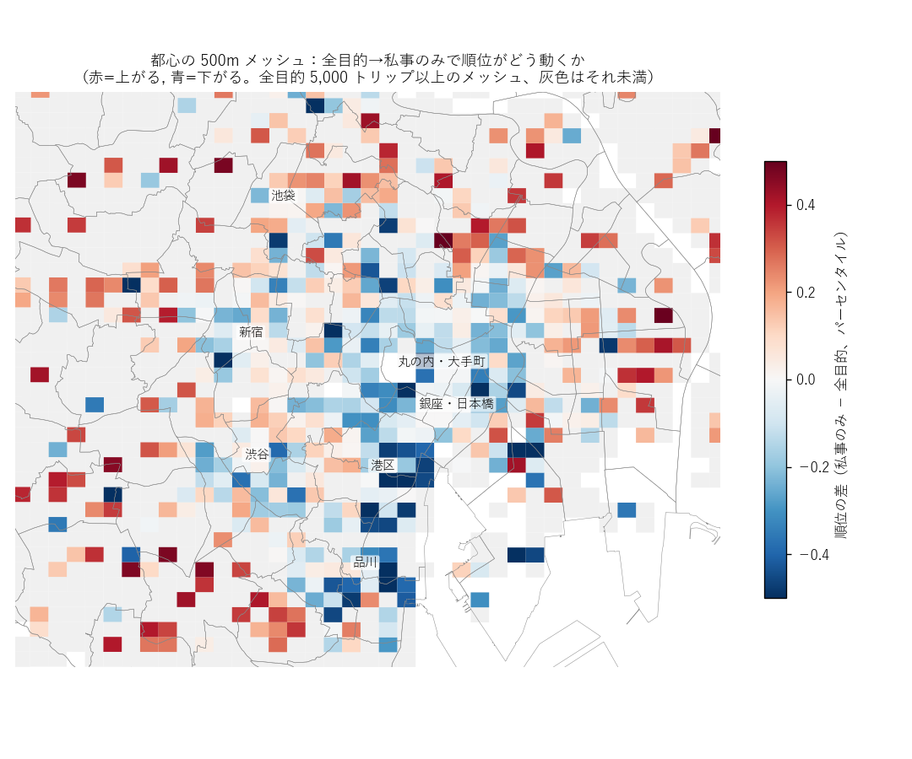
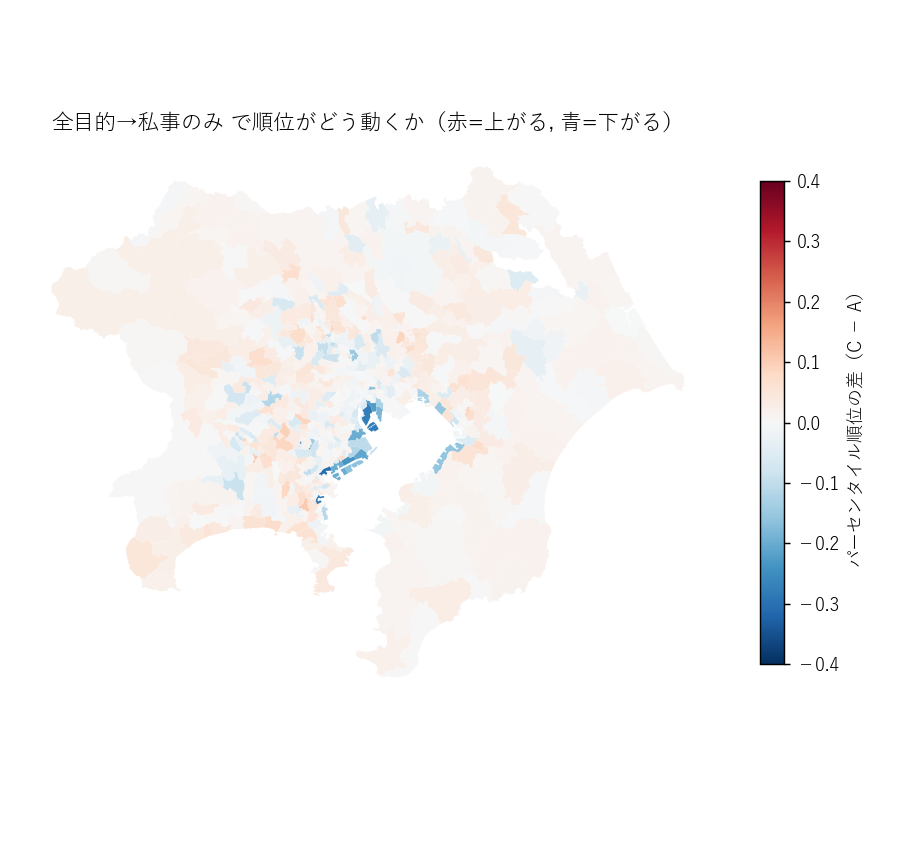
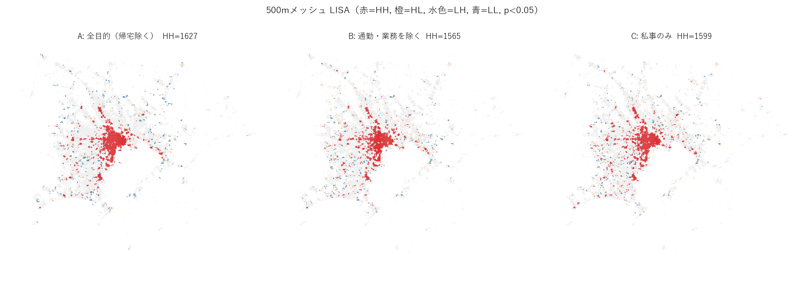
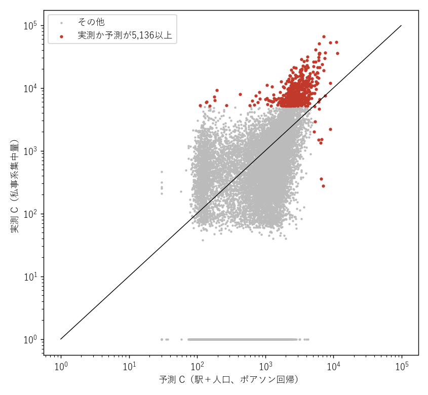
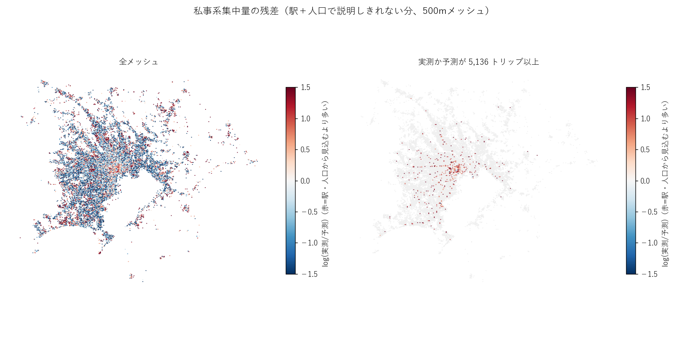
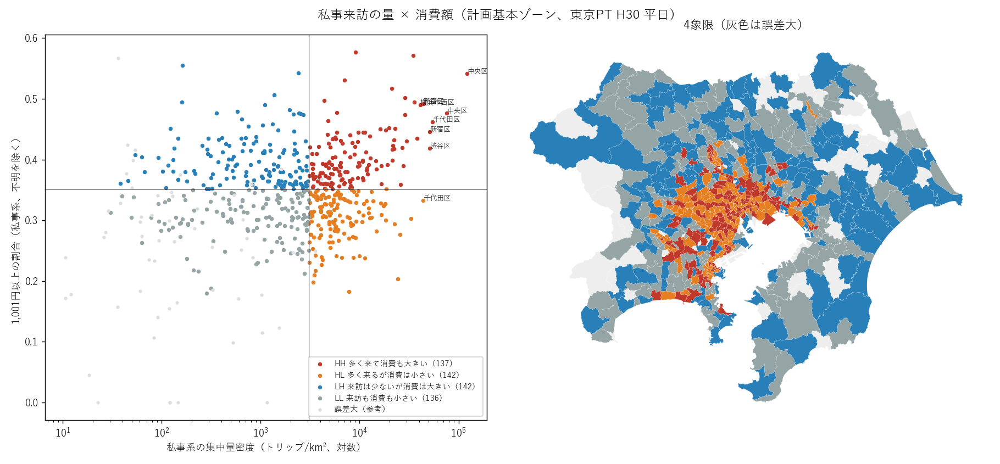

# 東京PT（H30）で「にぎわい」の仮説を検証する：P1・P3・P4 の結果（2026-11-08）

東京都市圏パーソントリップ調査（H30、2018年、平日）の公開集計表を使い、コンペ開始（2026-11-16）前に3つの仮説を検証した。
PT は予測モデルには使わない。仮説を方向と順位の形で固めておき、コンペの GPS 人流で再現するかを確かめるために使う（親 issue #13、背景は [literature_review.md](literature_review.md)）。

| | 仮説 | 結論 | issue |
|---|---|---|---|
| P1 | H1：勤務者を除くかどうかで、にぎわいの地図は大きく変わる | **500m メッシュでは大きく変わる。計画基本ゾーンではほとんど変わらない** | #10 |
| P3 | H2：来訪者の量の大部分は駅と人口で説明でき、残差に「質」が現れる | **半分だけ当たる。駅＋人口で説明できるのは3割。来訪向け業種の従業者数を足すと7割** | #11 |
| P4 | H3：「集まる」と「にぎわいを生む（消費）」は別の現象 | **支持される。量と消費額はほぼ無関係で、消費額は着施設の種類で決まる** | #12 |

## 共通の前提

- 使った値は**集中量**（そのゾーン・メッシュに着いたトリップ数、拡大後）。その時刻にいる人数（滞留人口）ではない。目的別の滞留人口と滞在時間は公開集計表に無い。
- **私事系** = 自宅－私事 ＋ 私事（自宅以外から出た私事を含む）。**業務系** = 自宅－勤務 ＋ 自宅－業務 ＋ 勤務・業務。
- 抽出率は約1%。相対誤差の目安は `rse = 21.5 / √トリップ数`（データ利用の手引きの「21,000トリップで約15%、5,000で約30%」から逆算）。相対誤差 30% 以内になるのは **5,136 トリップ以上**で、これを「誤差の小さい」目安にした。
- 平日のみ。休日の買い物・観光は捉えていない。

---

## P1 勤務者を除くと、にぎわいの地図はどれだけ変わるか

### 方法

3つの地図を比べた（いずれも帰宅を除く集中量）。

- **A 全目的**：集中量合計 − 帰宅
- **B 通勤・業務を除く**：A − 業務系
- **C 私事のみ**：私事系

計画基本ゾーン（615件）は面積あたりの密度、500m メッシュ（13,306件、mesh-1 に載るもの）はトリップ数で比べた。
指標は Spearman 順位相関、上位30の重なり、LISA（局所モラン I、p<0.05）の HH（周りも高いホットスポット）の入れ替わり。

### 結果

| 単位 | A–C 順位相関 | 上位30の重なり | A の HH のうち C で外れた割合 |
|---|---|---|---|
| 計画基本ゾーン（615件） | 0.98 | 80% | 3% |
| 計画基本ゾーン（A の上位10%、62件） | 0.87 | 80% | — |
| 500m メッシュ（13,306件） | 0.80 | 53% | 22% |
| 500m メッシュ（A ≥ 5,000 トリップ、1,225件） | **0.59** | 53% | — |

全ゾーンの順位相関が高いのは、都心と郊外の差が大きいためである。上位ゾーンに絞ると相関は下がるが、それでも地図の骨格は変わらない。
一方、500m メッシュでは上位の半分が入れ替わる。



青（順位が下がる）は、丸の内・大手町から新橋・浜松町・品川にかけてのオフィス街に集まる。赤（上がる）は、池袋・新宿三丁目などの商業地と、周辺の住宅地の駅前である。

| メッシュ（代表的な場所） | A の順位 | C の順位 |
|---|---|---|
| 新宿区（新宿駅） | 1 | 2 |
| 千代田区（丸の内・大手町） | 2 | **91** |
| 横浜市西区（横浜駅） | 4 | 1 |
| 港区 | 13 | 46 |
| 新宿区 | 16 | 98 |
| 千代田区 | 30 | **360** |
| 町田市 | 37 | 11 |

計画基本ゾーン単位で見ても、順位が下がるのは臨海部と業務地である。



ゾーン単位の順位の動き（C − A）と属性の順位相関は次のとおり。

| 属性 | 順位相関 |
|---|---|
| 業務系の比率 | −0.68 |
| 昼夜比（14時/4時の滞留人口） | −0.43 |
| 駅乗降客数の密度 | +0.04 |
| 夜間（4時）滞留密度 | −0.03 |

LISA で見ると、ホットスポットの形は大きくは変わらない。ただし都心の核の周りで入れ替わりがある。



### 示唆

- 予測単位が細かいほど、勤務者を含めるかどうかで正解の地図が変わる。コンペの仕様（#1・#2）で、単位と勤務者の扱いを確認する。
- 順位の動きを説明するのは業務系の比率で、駅の乗降客数では説明できない。オフィスの集まり具合（業務系の従業者数など）を特徴量に入れる。

---

## P3 来訪者の量を駅と人口で説明し、残差を見る

### 方法

500m メッシュの私事系集中量を目的変数にした。抽出誤差の大きい小さいメッシュに引きずられないよう、最小二乗ではなく**ポアソン回帰**（対数リンク）で当てた。

追加の入力は次の2つ（e-Stat、2分の1地域メッシュ）。

- 2020年国勢調査の人口
- 2016年経済センサス活動調査の産業別従業者数

駅は国土数値情報 S12 の 2018年乗降客数を、メッシュ重心からの距離で減衰させて合計した（σ=400m、ほかに 1km 以内の合計）。周辺人口は 5×5 メッシュ（約2.5km四方）の合計。
評価は逸脱度の説明率 D² と、2次メッシュ（約10km四方）単位で地域を分けた 5 分割交差検証。

### 結果

| モデル | D² | 空間ブロック CV の D² |
|---|---|---|
| 人口のみ（自メッシュ＋周辺） | 0.15 | 0.12 |
| 駅のみ | 0.32 | 0.30 |
| **駅＋人口（ベースライン）** | **0.33** | **0.30** |
| ＋全産業の従業者 | 0.48 | 0.47 |
| ＋小売・飲食・生活関連の従業者 | 0.66 | 0.66 |
| ＋オフィス系（情報通信・金融・学術専門）の従業者 | **0.70** | **0.70** |

- 効いているのは生活関連サービス・娯楽の従業者。小売・飲食は、生活関連と同時に入れるとほぼ効かない。
- 全件と交差検証の値がほぼ同じで、地域を分けても過学習は見られない。

ベースライン（駅＋人口）の予測と実測を並べると、大きいメッシュほど予測が足りない。





**見込みより多い場所**（実測か予測が 5,136 トリップ以上のメッシュ）

- 駅から離れた大型の商業施設とみられるメッシュ：富士見市・入間市・成田市・武蔵村山市・土浦市など。駅アクセスはほぼ0なのに、私事系は 5,000〜9,000 トリップある。
- 商業中心：横浜駅西口、八王子、町田、立川、銀座（中央区）など。

**見込みより少ない場所**

- 駅には近いが、人が来る施設のないメッシュ：代々木公園・新宿御苑・築地付近、乗降客数だけが大きいオフィス街。

施設名は位置と値からの推定で、個別には確認していない。

残差との順位相関は、業務系の比率が −0.41、居住地からの平均距離が −0.38 だった。見込みより多い場所は業務が少なく、近くから来る人が多い。

**鈴木（2014）の到着数原単位**（私事系集中量 ÷ 小売・飲食・生活関連の従業者数）

| | 値（トリップ/人・日） |
|---|---|
| 中央値 | 約6 |
| 10〜90% | 1.8〜18.6 |
| 高い場所 | 郊外の駅前（藤沢・杉並・横浜市青葉区・練馬など）で 10〜20 |
| 低い場所 | 都心のオフィス街（丸の内・大手町・港区）で 1 前後 |

### 示唆

- ベースラインの特徴量は「駅（距離減衰）＋周辺人口」では足りない。経済センサスの業種別従業者数（特に生活関連・娯楽）を最初から入れる。
- 駅から離れた大型商業施設は駅の特徴量で拾えない。施設の位置（POI・大規模小売店舗）か、道路アクセスの特徴量（#6）が必要。
- 公園や駅だけのメッシュは過大予測になりやすい。土地利用（公園・緑地）を入れる。

---

## P4 私事来訪の「量」と「消費額」で場所を類型化する

### 方法

表4-4（目的別消費額別発生集中量）と表4-2（目的別発生集中量の発着施設構成）から、計画基本ゾーンごとに私事系の集中量を消費額区分と着施設に分けた。
私事系の合計は 4-4・4-2・c-2 で一致する（1,874万トリップ）。消費額不明は 4%。

- 主指標は**高消費率**（1,001円以上の割合、不明を除く）。区分の代表値で平均消費額も概算したが、10,001円以上の代表値が仮置きなので参考にとどめる。
- 4象限は、私事系の密度と高消費率をそれぞれ中央値で分けた（中央値は私事系 5,136 トリップ以上の 557 ゾーンで決める）。

### 結果

**量と消費はほぼ無関係**

| 指標の組 | 順位相関 |
|---|---|
| 私事系の密度 × 高消費率 | 0.08 |
| 私事系の密度 × 平均消費額（概算） | 0.06 |

**消費額は着施設の種類で決まる**

| 着施設の割合 | 高消費率との順位相関 | 量との順位相関 |
|---|---|---|
| 小売（大規模＋小規模） | **+0.57** | +0.06 |
| 大規模小売店 | +0.54 | +0.14 |
| アミューズメント施設 | +0.25 | +0.19 |
| 飲食施設 | +0.12 | **+0.52** |
| 公園・自然地・スポーツ施設等 | −0.29 | −0.29 |
| 学校・保育・文化施設 | −0.55 | +0.01 |
| 住宅・学校・医療・福祉 | **−0.56** | −0.16 |
| 業務系の比率（P1） | +0.07 | +0.01 |

飲食は人を集めるが、1件あたりの消費額は押し上げない。小売、特に大規模小売店は消費を押し上げるが、量とは関係が薄い。



| 象限 | ゾーン数 | 着施設の特徴（私事系トリップの構成比） | 代表的な場所 |
|---|---|---|---|
| HH 多く来て消費も大きい | 137 | 大規模小売 20%、飲食 11% | 銀座・日本橋、新宿、横浜駅、大宮、浦和、錦糸町・押上、池袋、上野 |
| HL 多く来るが消費は小さい | 142 | 大規模小売 11%、学校・文化 17%、医療 10% | 丸の内・大手町、文京区（病院・大学）、江東区臨海部 |
| LH 来訪は少ないが消費は大きい | 142 | 大規模小売 17% | 郊外の大型商業施設のゾーン（船橋・三郷・入間・印西・酒々井）、箱根 |
| LL 来訪も消費も小さい | 136 | 公園・スポーツ 12%、学校・文化 17%、福祉・住宅が多い | 郊外の住宅地 |

### 注意：個々のゾーンの象限は標本誤差に埋もれる

- 高消費率の標準誤差は中央値 0.063 で、ゾーン間の四分位範囲 0.085 とほぼ同じ大きさ。
- 消費側の分類が 95% で確かなのは、557 ゾーン中 **37** だけ。
- 上の相関は 557 ゾーン全体の傾向なので有効（誤差はむしろ相関を弱める方向に働く）。ただし「このゾーンは HH」といった個別の判定には使えない。個別に使うなら、市区町村か中ゾーンにまとめる必要がある。

### 示唆

- 「量」に効く特徴量（駅・人口・飲食・生活関連、P3）と、「消費」に効く特徴量（大規模小売の有無・床面積）は別である。目的変数が量なら、大規模小売は P3 の「駅から離れた大型商業施設」を補正する特徴量として入れる。
- 学校・医療・公園の割合は、量はそこそこあっても消費が小さい場所の目印になる。目的変数に滞在時間や消費の要素があれば、負の特徴量として効く見込み。

---

## まとめ：コンペに持ち込む仮説

方向と順位の形で書き留めておく。GPS 人流で再現しないときは、平日のみ・2018年・集中量（滞留ではない）という PT 側の違いから原因を切り分ける。

1. **勤務者の扱いで正解の地図が変わる。** 500m メッシュでは、勤務者を除くと丸の内・大手町・品川などのオフィス街の順位が大きく下がり、池袋・町田などの商業地が上がる。順位の変化は業務系の比率で説明でき、駅の乗降客数では説明できない。
2. **駅と人口だけでは足りない。** 来訪の量のうち駅＋人口で説明できるのは3割で、来訪向け業種の従業者数（特に生活関連・娯楽）を加えると7割になる。
3. **駅から離れた大型商業施設と、駅前の公園・オフィス街は、駅の特徴量で外れる。** 前者は過小予測、後者は過大予測になる。
4. **量と消費は別の特徴量で説明される。** 飲食は量、小売（特に大規模小売）は消費に効く。学校・医療・公園は消費を下げる。

## 限界

- 集中量は「着いたトリップ数」で、滞留人口ではない。目的別の滞留人口と滞在時間は、PT データ集計システム（要利用者登録、#5）で取れるかを確認中。
- 平日のみ・2018年。休日の買い物・観光、コロナ禍後の変化は含まない。
- 人口は2020年、従業者数は2016年で、PT の2018年とずれる。
- 駅の位置は国土数値情報の路線線分の重心から作った近似。
- 施設名は位置と値からの推定で、個別には確認していない。

## 再現方法

`mapsuke/` で次を順に実行する（QGIS 不要）。入力データの入手元と列の説明は [mapsuke/README.md](../mapsuke/README.md)。

```
python -I scripts/build_purpose_h30.py     # #5 目的別集中量
python -I scripts/analyze_p1_h30.py        # P1
python -I scripts/analyze_p3_h30.py        # P3
python -I scripts/analyze_p4_h30.py        # P4
python -I scripts/report_figs_pt_h30.py    # 本書の図を docs/figures/pt_h30/ に出す
```

結果の表は `mapsuke/output/p1・p3・p4/*.csv`、レイヤは `mapsuke/data/p1_h30.gpkg`・`p3_h30.gpkg`・`p4_h30.gpkg`（いずれも Git 管理外）。
